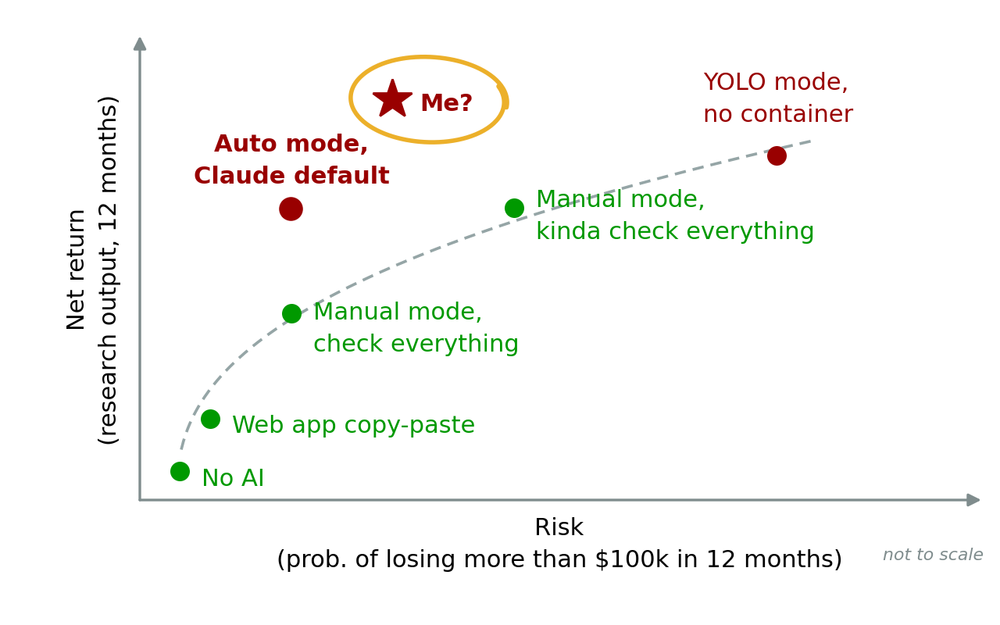

# EconYoloBox

EconYoloBox is an ergonomic, AI-forward environment for economics research. It
was built by obsessively improving my research workflow (instead of doing
actual research work).

— Andrew Y. Chen

## Philosophy

- **AI usage is a risk-return tradeoff**: We all want to be on the frontier.
  EconYoloBox helps you get there, with your preferred tradeoff.
- **AIs are like human co-authors**: Every team is different. Good teams learn
  by doing, together. EconYoloBox makes working together smooth and efficient.
- **AI changes constantly**: I'm just gonna update this repo as new developments
  arrive. Don't pull blindly. Watch the repo if you wanna see what I'm up to.
  Dated release tags (`vYYYY.MM.DD`) will mark notable checkpoints.

<p align="center">
  
</p>


## Key features

1. **Sandboxed YOLO mode, with an easy "normie" mode switch**

   - **YOLO mode** is the default. It has a firewall and filtered system calls,
     so Claude Code and Codex can run unsupervised and efficiently. Don't waste
     time or tokens approving commands. *Cook!*
     - Is my *cooking* too spicy? Adjust `.devcontainer/init-firewall.sh`
       to your palate. Turn off all internet, except for the model providers, if
       you prefer mild.
   - **Normie mode** opens a second container with open internet and
     unfiltered system calls. Use it for work blocked in YOLO mode (searching
     arbitrary websites, installing packages). Like normies, use Claude
     "auto mode" and Codex `auto_review` for safety.
   - **The YOLO and normie containers share package volumes.** R, Python,
     TeX Live and the VS Code extensions live in their own volumes. Normie mode
     can write to them, but YOLO mode has read-only access. Packages you
     install in normie mode are available in YOLO mode, but YOLO agents can't
     install packages (including malicious ones) to these volumes.
   - See [the command interface](#one-interface-two-modes) and
     [isolation and approval limits](docs/features.md#1-safe-yolo-agents).

2. **Ergonomic container and AI access**

   - **One box for all your research.** In my experience, having one big
     container is the way to go for volatile economics research
     projects—especially if you sync via Dropbox like I do. This box does it
     all for me. I hope it does the same for you.
   - **One command interface, two modes.** `yolobox` opens shells, VS Code,
     Claude, and Codex with a consistent set of flags. Shortcuts pair everyday
     YOLO and normie commands: `ybcc` / `nbcc`, `ybgpt` / `nbgpt`, and more.
     See the table below.

3. **Economics-research AI tooling**

   - Use a container image designed for fast R and Python package installation.
   - Search the literature with a custom OpenAlex citation-lookup tool.
   - Convert PDFs to Markdown with high fidelity using a tool built on Mistral
     OCR (h/t Don Bowen).

## One interface, two modes

EconYoloBox gives you **two containers for the same workspace**: YOLO and
normie. Both mount the same project files and share package volumes, so edits
in either are immediately visible in the other. They can run at the same time.

Run these commands from a **host terminal** after the
[host command setup](#optional-host-command-workflow). Each command starts its
container if needed, then opens the requested tool for your project:

| What to open | In the YOLO container | In the normie container |
|---|---|---|
| A terminal shell inside a container | `ybe` | `nbe` |
| VS Code connected to a container | `ybcode` | `nbcode` |
| A Claude Code session running inside a container | `ybcc` | `nbcc` |
| A Codex session running inside a container | `ybgpt` | `nbgpt` |

**YOLO** runs agents without permission prompts inside a container with a
firewall, filtered system calls, and read-only package volumes. **Normie** has
open internet and writable package volumes; its agent launchers select Claude
auto mode or Codex Approve for me. Opening one container keeps sessions in the
other running.

Pass a project directory, or omit it to use your current directory. From the
checkout root:

```zsh
ybcc workshop/My-Project                     # Claude in YOLO mode
ybgpt workshop/My-Project                    # Codex in YOLO mode
nbgpt workshop/My-Project -- resume --last    # resume Codex in normie mode
nbe workshop/My-Project                      # open a normie shell
```

For YOLO agents, use a host terminal or a local VS Code terminal: attaching
VS Code to YOLO can expose its host credential relay. See the
[GitHub authentication details](.devcontainer/README.md#github-auth).

For the full interface and container management, run `yolobox --help` or see
the [command guide](docs/commands.md). For the broader sandbox
design and its limits, see [Yolobox Features](docs/features.md).

## Minimal setup

These instructions are for macOS and use VS Code as the primary interface. This
minimal path gets the container and AI agents running without research
credentials or the optional R and Python package stacks.
Windows and Linux support is partially wired but has not been tested.

1. **Install the host applications:**

   - [Git](https://git-scm.com/download/mac)
   - [Docker Desktop](https://www.docker.com/products/docker-desktop/)
   - [Visual Studio Code](https://code.visualstudio.com/)
   - Python 3 (macOS: `xcode-select --install`)

   Open Docker Desktop after installing it and wait until it reports that the
   Docker engine is running. Leave Docker Desktop running while using
   EconYoloBox.

2. **Install the host VS Code extensions.** Open VS Code and select the
   Extensions icon in the left sidebar. Install `Dev Containers` by Microsoft.
   If you use the PDF viewer, also install `PDF` by tomoki1207 here; it runs in
   host VS Code, not in the container.

3. **Clone EconYoloBox in VS Code.** Open the Command Palette with
   **Shift–Command–P**, select **Git: Clone**, and enter:

   ```text
   https://github.com/chenandrewy/EconYoloBox.git
   ```

   Choose a destination folder, then click **Open** when VS Code
   asks whether to open the cloned repository.

4. **Build and open the container.** In the cloned repository's VS Code window,
   open the Command Palette and select **Dev Containers: Reopen in Container**.
   When VS Code asks which configuration for a fresh checkout, pick the one
   named `(normie)` to install extensions first.

   Wait for the first build to finish. It also installs the base R, Python
   and TeX Live stacks and, at first start, the Claude Code and Codex CLIs, so
   expect it to take a while longer than later rebuilds. VS Code reloads with
   `Dev Container` shown in the lower-left corner when it is ready. In its
   integrated terminal, run `bash .devcontainer/setup/install-vscode-extensions.sh`
   and check that every workspace extension passes. Stay in normie for the
   first agent launch below; the host commands let you choose YOLO afterward.

   To add or drop extensions, edit the list at the top of that script and
   rerun it in normie; see
   [VS Code extensions](.devcontainer/setup/README.md#vs-code-extensions).
   Installing from the Extensions sidebar in normie also works, and YOLO
   sees the result, but the script does not know about it: a fresh extension
   volume will not get it back.

   To adjust YOLO's internet allowlist, edit
   `.devcontainer/init-firewall.sh`. See
   [sandbox validation and limits](.devcontainer/README.md#codex-sandbox-modes-and-launchers)
   for the interaction between container isolation and agent permissions.

5. **Create or clone a project.** Select **Terminal → New Terminal** in VS Code.
   The yolobox repository is mounted at `/yolobox`; all user content goes
   under `/yolobox/workshop/`, which `.gitignore` excludes wholesale, so the
   outer EconYoloBox repository never sees your projects whatever they are
   named. Each project must therefore be its own Git repository. Projects that
   are finished or retired move to `/yolobox/hangar/`, which is ignored the same
   way; `workshop/` holds only active work.

   For a new project:

   ```bash
   mkdir -p /yolobox/workshop/My-Project
   git -C /yolobox/workshop/My-Project init
   ```

   For an existing project, clone its repository instead:

   ```bash
   cd /yolobox/workshop
   git clone https://github.com/your-name/your-project.git My-Project
   ```

6. **Start an AI agent in the normie container.** The first launch may ask
   you to authenticate. From the project directory, start Claude with auto mode
   selected:

   ```bash
   cd /yolobox/workshop/My-Project
   claude --permission-mode auto
   ```

   This uses Claude's automatic permission checks where
   [auto mode is available](https://code.claude.com/docs/en/permissions#permission-modes).
   If unavailable for your account or model, use `claude` with manual approvals.

   Or start Codex with:

   ```bash
   cd /yolobox/workshop/My-Project
   codex --sandbox workspace-write --ask-for-approval on-request -c approvals_reviewer=auto_review
   ```

   This selects Codex Approve for me for the session. See
   [Codex setup and limits](.devcontainer/README.md#codex-sandbox-modes-and-launchers)
   for persistent configuration and sandbox details. Use `/model` or
   `codex --model <model>` to choose a model.

   For everyday YOLO work, set up the host commands below and launch `ybcc` or
   `ybgpt` from your host project directory. These select the YOLO container and
   its guarded agent launcher together. If you are already in a YOLO shell,
   use `cchat-yolo` or `gptchat-yolo`; see
   [host versus container commands](docs/commands.md#host-versus-container-commands).

### Switching modes

Choose the matching shortcut in the table above. Each mode is a separate
container; switching does not stop existing sessions. Normie stays open until
stopped, so use `yolobox --stop --normie` when finished. The shell prompt and
VS Code title identify normie mode. See
[container management](docs/commands.md#container-management) for status,
stopping, and rebuilds.

## Recommended additions

The minimal setup works without these steps. Add the pieces needed for your
workflow after the container is running. For more, such as using one checkout
from several Macs, see [extended setup](docs/extended-setup.md).

### Give the Mac a short name

A short computer name keeps Claude session names readable: `MacBook25` is
clearer than `Andrews-MacBook-Pro`. Set it under **System Settings → General →
About → Name**. Reopen the container afterward so it picks up the new name.

### Save credentials for research tools

These credentials support WRDS, Mistral, and OpenRouter tools; they
are not needed to authenticate Claude or Codex. In the Mac's Terminal, open
your checkout root and run:

```bash
python3 credentials/setup.py
```

Press Enter to skip any service you do not use. The container receives the
credentials as environment variables when it is created, so a container that
already exists needs recreating to see new ones: `yolobox --rebuild`, which
recreates both modes' containers.

### Update the AI CLIs

The first start installs the Claude Code and Codex CLIs into a persistent
volume, so a rebuild does not undo an update. They do not update themselves;
to update both, in any mode:

```bash
bash /yolobox/.devcontainer/setup/install-base.sh cli
```

### Add to the package stacks

R, Python and TeX Live live in shared volumes that every project mounts,
read-only by default. The first build fills them with a lean base. For the rest
of the usual stack, or any other package, switch to normie mode with
`nbcode` on the host. Then, in the container:

```bash
bash .devcontainer/setup/install-optional.sh      # the rest of the usual stack
```

or `install.packages()`, `pip install` or `tlmgr install`. Switch back to YOLO
mode (`ybcode`, then `yolobox --stop --normie`) and run
`bash .devcontainer/setup/tests/test-packages.sh`. See [setup](.devcontainer/setup/README.md) and
the [devcontainer README](.devcontainer/README.md#working-modes) for the
details.

## Optional host command workflow

The commands in the table run in **zsh on the host**. Alongside the host
applications in Minimal setup, install Node.js/npm and the Dev Containers CLI.
For VS Code actions, enable the `code` CLI through **Shell Command: Install
'code' command in PATH** in VS Code's Command Palette. From the checkout root
in a host terminal:

```zsh
npm install -g @devcontainers/cli
bash .devcontainer/host/setup.sh
exec zsh
yolobox --help
```

The setup script registers the commands in your zsh configuration and checks
prerequisites. After setup, use any command in the table above. For example,
`ybcc workshop/My-Project` launches Claude in YOLO mode directly from the host.
See the [command guide](docs/commands.md) for the full interface and
[host toolkit setup](.devcontainer/host/README.md#setup) for registration details.

## Project layout

The whole checkout is bind-mounted at `/yolobox` in the
container. The yolobox itself is these tracked folders:

- `.devcontainer/`: container definitions, runtime support, host launchers,
  provisioning, and tests
- `agents/`: agent guidance, settings and skills; `agents/managed/` is the
  policy baked into the image
- `credentials/`: user-maintained credential mapping and host credential
  management
- `docs/`: design notes and the feature tour
- `tools/`: custom research tooling

I put my active projects in `workshop/`, finished projects in `hangar/` (for
reference) and literature in `cellar/`. These are ignored by Git (see
`.gitignore`). Having nested Git repos inside `workshop/` and `hangar/` works
for me.

## Devcontainer storage

Budget the container image (which carries a copy of the base stacks, about
1.5GB, to seed the volumes) plus about **5.7GB of volumes** for the first
yolobox checkout: 4.7GB of shared R, Python and TeX volumes, and 1GB of
per-checkout volumes (AI CLIs and their config). Each additional checkout adds
about 1GB, since the image and the package volumes are shared.

Docker's default 20GB BuildKit garbage-collection budget is adequate. If you
hit repeated slow rebuilds, raising it to 35GB gives headroom. See
[Devcontainer storage needs](docs/storage-needs.md) for the settings and for how
to confirm that eviction is the actual problem.

## TeX Live setup

The devcontainer uses a shared, pdfLaTeX-only TeX Live volume, read-only by
default, which the first build fills. See [setup](.devcontainer/setup/README.md) for adding
packages and for validation.

## License

EconYoloBox is released under the [MIT License](LICENSE).
