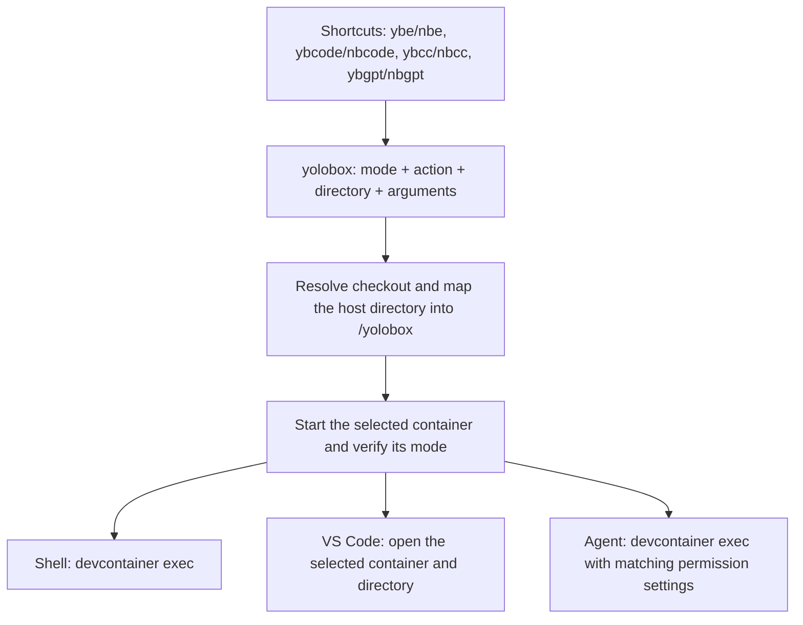

# Yolobox command guide

`yolobox` is the host interface for starting and managing the sandbox. Its
shortcuts select an action and a container mode, then use the same startup,
verification, and directory mapping as the full command. Run them in **zsh on
the host**, including a terminal in a local VS Code window.

For installation, see [host command setup](../README.md#optional-host-command-workflow).
Run `yolobox --help` to discover the interface; tab completion lists flags and
directories without starting Docker.

## Actions and shortcuts

| Action | YOLO | Normie |
|---|---|---|
| Shell | `yolobox --shell` → `ybe` | `yolobox --normie --shell` → `nbe` |
| VS Code | `yolobox --code` → `ybcode` | `yolobox --normie --code` → `nbcode` |
| Claude | `yolobox --claude` → `ybcc` | `yolobox --normie --claude` → `nbcc` |
| Codex | `yolobox --codex` → `ybgpt` | `yolobox --normie --codex` → `nbgpt` |

`yolobox` defaults to YOLO; `--yolo` names that mode explicitly. With no action,
it brings up and verifies the selected container, then returns to the host.
Shortcuts fix both their action and mode. A conflicting mode flag is an error:
use `nbe` or `yolobox --normie --shell` to open a normie shell.

## Directories and agent arguments

The directory defaults to your current host directory. Paths are relative to
that directory, or absolute; there is no automatic `workshop/` prefix. From the
checkout root:

```zsh
ybe workshop/My-Project
nbcode workshop/My-Project
ybcc workshop/My-Project -- --resume
nbgpt workshop/My-Project -- resume --last
```

The last command is equivalent to:

```zsh
yolobox --normie --codex workshop/My-Project -- resume --last
```

For agents, put launcher flags and the directory **before `--`**, and agent
arguments after it. Arguments after the separator are passed literally,
including quoted prompts, spaces, and shell punctuation. Launcher help and
agent help are separate:

```zsh
ybgpt --help                   # yolobox actions and shortcuts
ybgpt -- --help                # Codex help inside the YOLO container
ybgpt -- --model MODEL_NAME    # choose a model for this session
```

For shell and editor actions, `--` can instead introduce a directory whose
name begins with a dash. To run a shell command and return its exit status:

```zsh
nbe workshop/My-Project --command 'python3 analysis.py'
yolobox --normie --shell workshop/My-Project --command 'python3 analysis.py'
```

The command runs through the container's interactive zsh configuration, so its
functions and aliases are available. Agent launches also load that shell and
return to the host when the agent exits.

## How the commands connect



This is the launch path; status and stop use the same checkout resolution but
do not start a container. For launches, `yolobox` walks up from the requested
directory to find `.devcontainer/devcontainer.json`, selects the mode's config,
and verifies the container returned by `devcontainer up` before entering it.
The directory keeps its position within the checkout: host
`workshop/My-Project` becomes `/yolobox/workshop/My-Project`.

If the container has the wrong mode, an outdated mount layout, or a duplicate
container for the same mode, startup refuses and reports the repair command.
All shortcuts pass through these checks.

## Agent permissions

| Mode and agent | Launch inside the container |
|---|---|
| YOLO Claude (`ybcc`) | Guarded `cchat-yolo`; bypass permissions and enable remote control |
| YOLO Codex (`ybgpt`) | Guarded `gptchat-yolo`; bypass approvals and the Codex command sandbox |
| Normie Claude (`nbcc`) | `claude --permission-mode auto` |
| Normie Codex (`nbgpt`) | `codex --approve-for-me` |

Both Codex launchers first run `(cd /yolobox && codex app-server daemon start)`.
This starts a missing shared daemon from the stable mount root so deleting a
temporary worktree cannot remove its working directory. An existing daemon is
left running. The session opens in the selected directory, and a daemon startup
failure prevents the session from launching.

The YOLO wrappers refuse to start unless the container firewall is enabled and
PID 1 has filtered seccomp. The normie launchers explicitly select agent
permission settings; opening the normie container alone does not set them.
The agent CLIs must already be installed and support the requested modes.

Agent actions own their permission options. They reject permission overrides,
Codex profile/config overrides, and Claude settings overrides before container
startup. To choose a custom configuration, open the appropriate shell or use
`yolobox --shell --command` with the desired mode.

For YOLO agents, use the host launchers from a host terminal or a local VS Code
window. Attaching VS Code to YOLO with `ybcode` can expose VS Code's host
credential relay. Agent and shell launches use `devcontainer exec`, which does
not forward that relay. See [GitHub auth](../.devcontainer/README.md#github-auth)
and [agent sandbox limits](../.devcontainer/README.md#codex-sandbox-modes-and-launchers).

## Container management

| Command | Behavior |
|---|---|
| `yolobox [DIRECTORY]` | Bring up and verify YOLO; open no shell or editor. |
| `yolobox --normie [DIRECTORY]` | Bring up and verify normie. |
| `yolobox --status [DIRECTORY]` | Report both modes without starting or changing containers. |
| `yolobox --stop [DIRECTORY]` | Stop YOLO. |
| `yolobox --normie --stop [DIRECTORY]` | Stop normie. |
| `yolobox --rebuild [DIRECTORY]` | Recreate containers using Docker's build cache; bring up YOLO. |
| `yolobox --normie --rebuild [DIRECTORY]` | Recreate containers; bring up normie. |
| `yolobox --rebuild-without-cache [DIRECTORY]` | Recreate containers without Docker's build cache. |

YOLO and normie are separate containers for the same checkout. Both may run at
once and share project files, package volumes, and shell history. Each mode
has its own AI CLI installation and Claude/Codex home, so log in and update
the CLIs in each mode separately; transcripts stay shared through ai-sesh. Selecting one leaves the other running. A YOLO launch reports when
normie is also running; stop normie when finished with its open internet and
writable package volumes.

Rebuilds recreate the selected container and the other mode if it already
exists. They never create an unused second mode. If the other container was
stopped, it is stopped again after recreation. A rebuild refuses while VS Code
is connected to either container; close those remote windows first.

Combine a rebuild with an action to enter the selected container afterward:

```zsh
yolobox --normie --rebuild --shell workshop/My-Project
nbgpt --rebuild workshop/My-Project
```

VS Code's own **Rebuild Container** rebuilds only its window's mode. Package
and login volumes survive container rebuilds. See
[working modes](../.devcontainer/README.md#working-modes) for storage and posture
details.

Choose only one action: `--shell`, `--code`, `--claude`, `--codex`, `--stop`, or
`--status`. The mode flags and rebuild flags are also mutually exclusive within
their pairs. `--status` accepts an optional directory but no mode or rebuild
flag; `--stop` accepts a directory and mode but no rebuild flag.

## Host versus container commands

The eight shortcuts and `yolobox` are host functions registered by
`.devcontainer/host/setup.sh`. Inside a container, use the installed programs
and the functions from `.devcontainer/shellrc.sh`:

- `cchat-yolo` starts Claude in YOLO mode. It enables remote control and names
  sessions for the project folder, numbering simultaneous sessions. Set
  `CC_SESSION_NAME` to override the base name.
- `gptchat-yolo` starts Codex in YOLO mode; `gptmini-yolo` selects the smaller
  model configured in that wrapper.
- In normie, use `claude` or `codex` with the desired permission settings. The
  host commands `nbcc` and `nbgpt` supply the settings shown above for you.

The former public names `ybox`, `ybagent`, `nbagent`, and `nbcodex` are removed
when the host launcher loads. Open a new host terminal, or source
`.devcontainer/host/devcontainer.zsh` from the checkout root to refresh an
existing shell. The older `.devcontainer/host/ybe-gptchatyolo` script remains a
compatibility entry point forwarding to `ybgpt`.

For the source layout, shell registration, and tests, see the
[host toolkit README](../.devcontainer/host/README.md).
